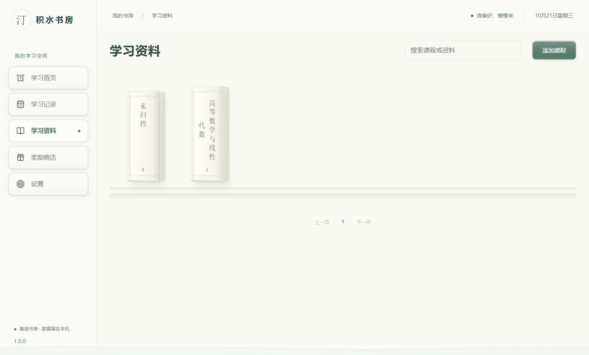

# 积水书房

离线 Windows 学习工作台。专注学习、整理课程资料，用积累的学习时间兑换自己设定的奖励；数据保存在本机。

[下载 v1 正式版](https://github.com/1xiaoyueryuer/study-workbench/releases/latest) · [开发说明](docs/development.md) · [版本追溯](docs/history.md) · [验收记录](docs/validation.md)

## 功能

- 学习计时：暂停、继续、全屏专注，约每 5 秒自动保存；锁屏和睡眠暂停，最小化继续。
- 课程书架：拖入文件、网页链接、搜索、移动与重命名；相同文件内容只存一份。
- 学习记录：累计与每日时长、会话笔记、每日复盘。
- 时间商店：奖励按分钟标价，直接扣可用学习时间，累计学习不减少。没有积分、随机掉落、收藏展示或仓库。
- 积水效果：水位对应本次目标进度；低动态模式、质量设置和图形失败退路。
- 数据管理：完整备份恢复、旧版数据迁移、缓存回收和空间统计。



## 安装与数据

从 Releases 下载 `StudyWorkbench-1.0.0-Setup.exe`，可用同页 `SHA256SUMS.txt` 校验。安装包包含 Electron 和 SQLite，无需 Node.js 或开发服务器；目前未签名。

默认数据目录 `%APPDATA%/study-workbench`，卸载默认保留数据。在设置中定期导出 `.studybackup`。升级至 v1 使用 schema4，旧版程序不能再写升级后的库；迁移前自动保留 `.before-v4` 数据库副本。课程、附件、学习记录和兑换收据保留。旧积分价格按 1 积分对应 1 分钟转为时间价格；未花掉的学习兑换时间归还可用余额，出售小奖品所得积分不再作为学习时间使用，详见版本追溯。

## 开发

先读 [agent.md](agent.md)。Node.js 24、npm 11、Windows x64；只在唯一开发工作树修改与测试。

```powershell
npm ci
$env:STUDY_DATA_DIR = Join-Path $PWD '.artifacts/data/dev'
$env:TEMP = Join-Path $PWD '.artifacts/tmp'
$env:TMP = $env:TEMP
New-Item -ItemType Directory -Force $env:TEMP | Out-Null
npm run dev
```

```powershell
npm run check       # 类型、lint、单元/集成/迁移、构建、真实 Electron 回归
npm run dist:win    # NSIS x64 安装包
npm run test:visual # 视觉与多尺寸布局
npm run test:memory # 固定 5 分钟暖机 + 60 分钟正式采样
```

源码采用保留版权的 `UNLICENSED` 状态。第三方组件与素材各自遵守原许可，见 [第三方告知](THIRD_PARTY_NOTICES.txt) 和 [素材来源](public/assets/SOURCES.md)。
